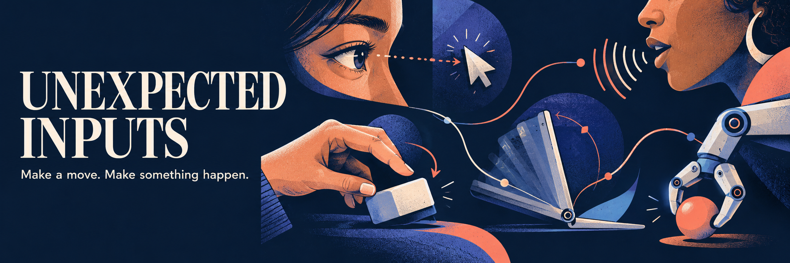
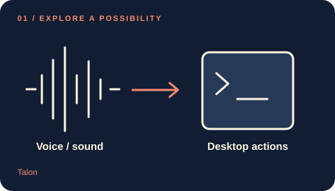
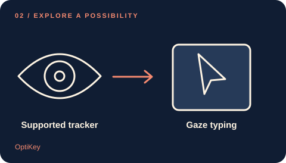
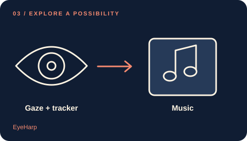
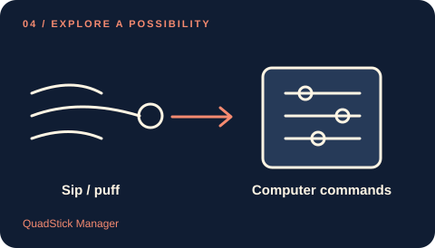
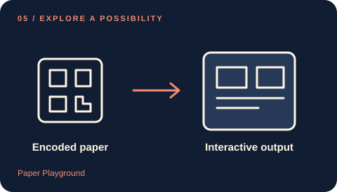
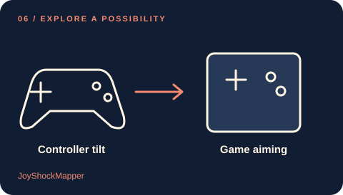

# Awesome Unexpected Inputs · 键鼠之外的交互方式

  

[English](README.md) · **简体中文**

**一个动作，打开一种新的交互方式。**

探索语音、视线、动作、呼吸与日常物件如何控制电脑。每个项目都说明：你做什么、什么检测它、最后能完成什么。

**33 个项目 · 7 个类别** — 24 已有使用方案 · 4 源码 / DIY 构建 · 3 研究 / 原型 · 2 归档 / 旧版。

[完整步骤与限制](docs/catalog.md) · [如何选择](docs/choose.md) · [竞品与选题依据](docs/landscape.md) · [离线搜索](docs/tooling.md) · [参与贡献](CONTRIBUTING.md)

封面和卡片是原创概念插画，不是实拍或测试证据。本项目核查了公开资料，尚未实测这些设备或操作。每条项目均链接原始来源；具体型号、系统版本和上游限制以详情为准。

## 六个值得先看的玩法

| | |
| --- | --- |
|  **[Talon](docs/catalog.md#talon)** 免手操作桌面 *已有使用方案* 需要: Microphone |  **[OptiKey](docs/catalog.md#optikey)** 眼动打字与桌面操作 *已有使用方案* 需要: Supported eye tracker for gaze |
|  **[EyeHarp](docs/catalog.md#eyeharp)** 用眼动演奏音乐 *已有使用方案* 需要: Separate Tobii eye tracker for gaze |  **[QuadStick Manager](docs/catalog.md#quadstick)** 可调节的吸吹命令 *已有使用方案* 需要: QuadStick hardware; new units currently sold out |
|  **[Paper Playground](docs/catalog.md#paper-playground)** 纸张成为程序界面 *源码 / DIY 构建* 需要: Webcam |  **[JoyShockMapper](docs/catalog.md#joyshockmapper)** 电脑游戏陀螺仪瞄准 *已有使用方案* 需要: DualSense, DualShock 4, paired Joy\-Cons, or Switch Pro Controller |

## 目录

[语音与声音](#voice-and-sound) · [视线与面部](#eyes-and-face) · [头部与身体](#head-and-body) · [空中手势](#hands-in-air) · [物件与表面](#objects-and-surfaces) · [倾斜与运动](#tilt-and-motion) · [呼吸与开关](#breath-and-switches)

## 语音与声音

把语音指令和非语言声音映射为电脑操作。

- **[LipSurf](https://www.lipsurf.com/)** — 用麦克风和 Chrome 扩展浏览网页、输入文本并执行命令。 *已有使用方案* · [来源](https://www.lipsurf.com/) · [配置与限制](docs/catalog.md#lipsurf).
- **[macOS Vocal Shortcuts](https://support.apple.com/en-euro/guide/mac-help/mchlf4548bb6/27/mac/27)** — 把训练过的词语或自定义声音关联到指定的 Mac 操作。 *已有使用方案* · [来源](https://support.apple.com/en-euro/guide/mac-help/mchlf4548bb6/27/mac/27) · [配置与限制](docs/catalog.md#mac-vocal-shortcuts).
- **[macOS Voice Control](https://support.apple.com/en-ie/guide/mac-help/mh40719/27/mac/27)** — 通过口述命令在 Mac 上打开应用、点击控件、滚动页面和输入文字。 *已有使用方案* · [来源](https://support.apple.com/en-ie/guide/mac-help/mh40719/27/mac/27) · [配置与限制](docs/catalog.md#mac-voice-control).
- **[Parrot\.py](https://github.com/chaosparrot/parrot.py)** — 训练自己选择的点击声、啾声等非语音声音，用来触发键盘和鼠标操作。 *研究 / 原型* · [来源](https://github.com/chaosparrot/parrot.py) · [配置与限制](docs/catalog.md#parrot-py).
- **[Talon](https://talonvoice.com/)** — 用语音命令和简短口腔声音操作桌面软件，也可配合眼动指针。 *已有使用方案* · [来源](https://talonvoice.com/docs/reference/official.html) · [配置与限制](docs/catalog.md#talon).
- **[VoiceAttack](https://www.voiceattack.com/)** — 把口述短语变成游戏控制、应用快捷键和多步骤宏。 *已有使用方案* · [来源](https://www.voiceattack.com/VoiceAttackHelpV2.pdf) · [配置与限制](docs/catalog.md#voiceattack).
- **[Windows Voice Access](https://support.microsoft.com/en-us/accessibility/windows/voice-access/get-started-with-voice-access)** — 下载语言模型后，通过本地语音识别控制 Windows 和输入文字。 *已有使用方案* · [来源](https://support.microsoft.com/en-us/accessibility/windows/voice-access/get-started-with-voice-access) · [配置与限制](docs/catalog.md#windows-voice-access).

## 视线与面部

用眼动与面部动作进行输入、选择、游戏和音乐创作。

- **[Android Camera Switches](https://support.google.com/accessibility/android/answer/11150722?hl=en)** — 把面部动作映射为扫描和选择操作，将手机前置摄像头用作开关输入。 *已有使用方案* · [来源](https://support.google.com/accessibility/android/answer/11150722?hl=en) · [配置与限制](docs/catalog.md#android-camera-switches).
- **[EyeGestures Demo](https://github.com/NativeSensors/EyeGestures)** — 运行基于摄像头的视线校准示例，作为开发自定义眼动界面的起点。 *源码 / DIY 构建* · [来源](https://github.com/NativeSensors/EyeGestures) · [配置与限制](docs/catalog.md#eyegestures).
- **[EyeHarp](https://eyeharp.org/)** — 通过目光选择音符来演奏乐器，也可使用头部追踪或其他指针设备。 *已有使用方案* · [来源](https://eyeharp.org/faq/) · [配置与限制](docs/catalog.md#eyeharp).
- **[EyeMine 2](https://www.specialeffect.org.uk/how-we-can-help/eyemine)** — 通过眼动操作的屏幕界面控制 Minecraft 中的移动、建造和采矿。 *已有使用方案* · [来源](https://www.specialeffect.org.uk/how-we-can-help/eyemine) · [配置与限制](docs/catalog.md#eyemine).
- **[GazePlay](https://gazeplay.github.io/GazePlay/)** — 通过能控制指针的眼动仪，用目光玩小游戏。 *已有使用方案* · [来源](https://gazeplay.github.io/GazePlay/) · [配置与限制](docs/catalog.md#gazeplay).
- **[iPhone Eye Tracking](https://support.apple.com/en-sa/guide/iphone/iph66057d0f6/ios)** — 使用前置摄像头跟踪视线，通过停留选择屏幕控件。 *已有使用方案* · [来源](https://support.apple.com/en-sa/guide/iphone/iph66057d0f6/ios) · [配置与限制](docs/catalog.md#iphone-eye-tracking).
- **[Look to Speak](https://play.google.com/store/apps/details?id=com.androidexperiments.looktospeak)** — 用眼睛动作选择预设短语或图片，让手机朗读选择的内容。 *已有使用方案* · [来源](https://play.google.com/store/apps/details?id=com.androidexperiments.looktospeak) · [配置与限制](docs/catalog.md#look-to-speak).
- **[OptiKey](https://optikey.org/)** — 通过注视、停留或兼容开关选择屏幕键盘和桌面控件，也能朗读输入的文字。 *已有使用方案* · [来源](https://github.com/OptiKey/OptiKey/wiki/Optikey-versions) · [配置与限制](docs/catalog.md#optikey).
- **[Project Gameface](https://github.com/google/project-gameface)** — 结合头部运动与面部动作移动光标并触发配置的操作。 *归档 / 旧版* · [来源](https://github.com/google/project-gameface) · [配置与限制](docs/catalog.md#project-gameface).
- **[WebGazer Ball Collision Demo](https://webgazer.cs.brown.edu/)** — 在浏览器演示中，用估计的注视位置引导橙色球靠近蓝色目标。 *研究 / 原型* · [来源](https://webgazer.cs.brown.edu/) · [配置与限制](docs/catalog.md#webgazer-ball-game).

## 头部与身体

用动作移动指针、改变游戏视角或创作声音。

- **[AITrack](https://github.com/AIRLegend/aitrack)** — 用摄像头估计头部位置，并发送给 opentrack 控制兼容模拟器的视角。 *已有使用方案* · [来源](https://github.com/AIRLegend/aitrack) · [配置与限制](docs/catalog.md#aitrack).
- **[Body Synth](https://experiments.withgoogle.com/body-synth)** — 在摄像头前移动身体来创作音乐，也可通过语音改变和弦或乐器。 *研究 / 原型* · [来源](https://experiments.withgoogle.com/body-synth) · [配置与限制](docs/catalog.md#body-synth).
- **[Enable Viacam](https://eviacam.crea-si.com/)** — 使用普通摄像头把头部运动转成指针移动，并可通过停留点击。 *已有使用方案* · [来源](https://eviacam.crea-si.com/index.php) · [配置与限制](docs/catalog.md#eviacam).
- **[macOS Head Pointer](https://support.apple.com/en-ie/guide/mac-help/mchlb2d4782b/27/mac/27)** — 通过摄像头捕捉头部运动来移动 Mac 指针，并搭配其他点击方式。 *已有使用方案* · [来源](https://support.apple.com/en-ie/guide/mac-help/mchlb2d4782b/27/mac/27) · [配置与限制](docs/catalog.md#mac-head-pointer).
- **[opentrack](https://github.com/opentrack/opentrack)** — 将头部运动转换为兼容游戏中的视角移动，也提供基于摄像头的神经网络输入。 *已有使用方案* · [来源](https://github.com/opentrack/opentrack/wiki/AI-Face-Tracking/3d839e36c47074ad40de570e1abfb0dce865fd37) · [配置与限制](docs/catalog.md#opentrack).
- **[SmoothTrack](https://smoothtrack.app/)** — 通过 opentrack，把手机摄像头变成电脑游戏的头部追踪器。 *已有使用方案* · [来源](https://smoothtrack.app/) · [配置与限制](docs/catalog.md#smoothtrack).

## 空中手势

配合指定追踪硬件，让手部动作变成非接触式控制。

- **[Ultraleap TouchFree \(legacy\)](https://docs.ultraleap.com/TouchFree/touchfree-user-manual/setup.html)** — 通过手部追踪移动指针，并用悬停或虚拟平面操作屏幕控件。 *归档 / 旧版* · [来源](https://docs.ultraleap.com/TouchFree/touchfree-user-manual/setup.html) · [配置与限制](docs/catalog.md#touchfree).

## 物件与表面

让纸张、标记和导电材料成为程序界面。

- **[Makey Makey Piano and Scratch](https://makeymakey.com/blogs/how-to-instructions/lesson-two-hands-on-a-makey-makey)** — 把可导电的日常物件接成键盘输入，用来弹奏浏览器钢琴或控制 Scratch。 *已有使用方案* · [来源](https://makeymakey.com/blogs/how-to-instructions/lesson-two-hands-on-a-makey-makey) · [配置与限制](docs/catalog.md#makey-makey).
- **[Paper Playground](https://phetsims.github.io/paper-land/)** — 移动印有编码的纸张，通过摄像头控制交互式网页程序、声音及其他输出。 *源码 / DIY 构建* · [来源](https://phetsims.github.io/paper-land/) · [配置与限制](docs/catalog.md#paper-playground).
- **[reacTIVision](https://reactivision.sourceforge.net/)** — 追踪实体物件上的打印标记，将运动信息发送给 TUIO 客户端或 MIDI 软件。 *已有使用方案* · [来源](https://reactivision.sourceforge.net/) · [配置与限制](docs/catalog.md#reactivision).

## 倾斜与运动

用陀螺仪、手机和小型开发板进行瞄准、指针和音乐控制。

- **[JoyShockMapper](https://github.com/Electronicks/JoyShockMapper)** — 把兼容手柄的陀螺仪映射为鼠标瞄准，并为电脑游戏配置 flick\-stick 或动作绑定。 *已有使用方案* · [来源](https://github.com/Electronicks/JoyShockMapper) · [配置与限制](docs/catalog.md#joyshockmapper).
- **[micro:bit Scratch Theremin](https://microbit.org/projects/make-it-code-it/scratch-theremin/)** — 倾斜 micro:bit，在 Scratch 项目中改变音高。 *源码 / DIY 构建* · [来源](https://microbit.org/projects/make-it-code-it/scratch-theremin/) · [配置与限制](docs/catalog.md#microbit-theremin).
- **[Mobile Mouse Air Mouse](https://mobilemouse.com/guides/iphone-air-mouse/)** — 按住屏幕上的触发按钮，在空中移动 iPhone 来控制电脑指针。 *已有使用方案* · [来源](https://mobilemouse.com/guides/iphone-air-mouse/) · [配置与限制](docs/catalog.md#mobile-mouse-air).

## 呼吸与开关

用专用接口，把吹吸、开关和小幅动作转成输入。

- **[Intel ACAT](https://github.com/intel/acat)** — 通过配置的开关或摄像头输入选择扫描式键盘，并用语音输出交流。 *已有使用方案* · [来源](https://github.com/intel/acat) · [配置与限制](docs/catalog.md#acat).
- **[LipSync 4\.1](https://github.com/makersmakingchange/LipSync)** — 结合嘴部操作的摇杆与吸吹输入，通过开源硬件控制鼠标或游戏手柄。 *源码 / DIY 构建* · [来源](https://github.com/makersmakingchange/LipSync) · [配置与限制](docs/catalog.md#lipsync).
- **[QuadStick Manager](https://www.quadstick.com/downloads)** — 配置 QuadStick 的吸吹压力阈值和映射，用来操作游戏与电脑。 *已有使用方案* · [来源](https://quadstick.s3.amazonaws.com/documents/user_manual/um/sip_puff_tab.htm) · [配置与限制](docs/catalog.md#quadstick).

## 收录标准

我们收录有明确用途、原始证据和可解释条件的项目。研究演示、归档项目和可安装软件分别标注；源码公开不等于具备开源许可证。日期表示资料核查时间，不代表实测通过。欢迎通过 [Issue](https://github.com/KeWang0622/awesome-unexpected-inputs/issues/new/choose) 补充兼容性结果。

目录正文与原创示意图采用 [CC0](LICENSE)，脚本采用 [MIT](LICENSE-CODE)。外部项目保留各自许可证。详见 [研究方法](docs/methodology.md)、[图片来源](assets/README.md) 和 [测试记录](docs/testing.md)。

**Source review / 资料核查：2026-10-26** · [Machine-readable catalog](data/projects.json) · [Changelog](CHANGELOG.md)

**Explore next:** [awesome-device-afterlife](https://github.com/KeWang0622/awesome-device-afterlife) · [Awesome iPhone Duo](https://github.com/KeWang0622/awesome-iphone-duo)
